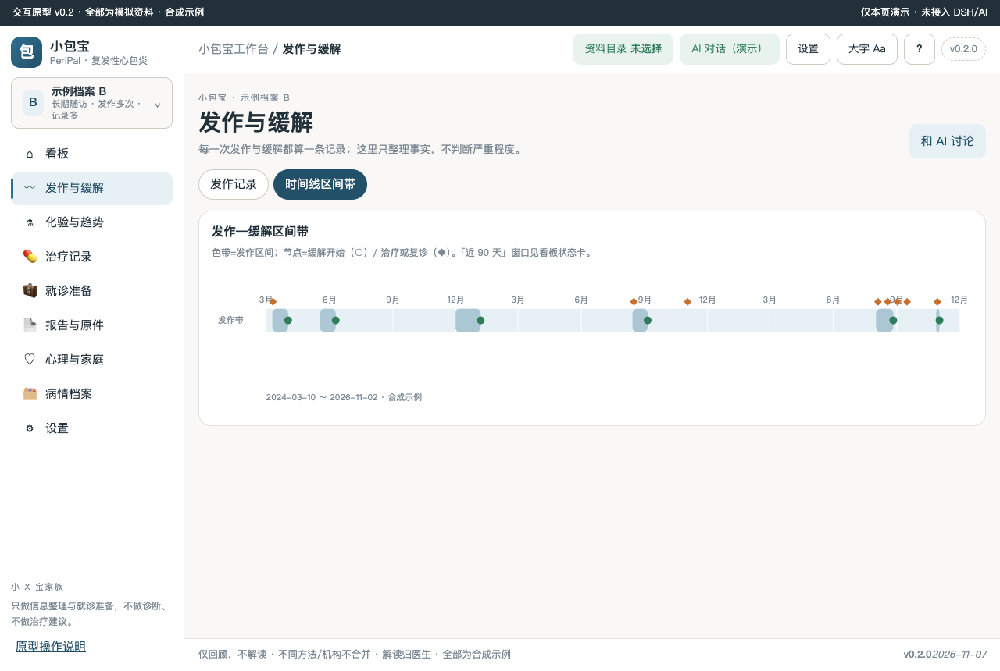
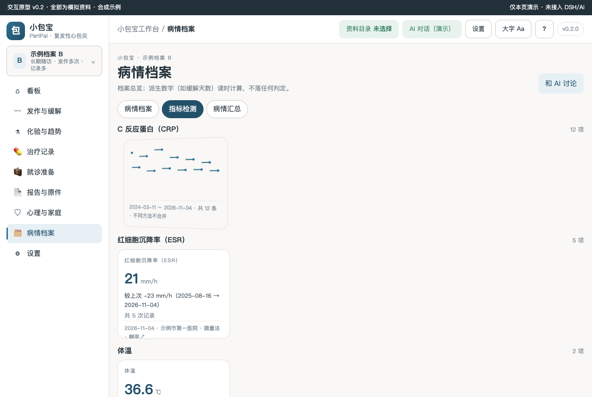
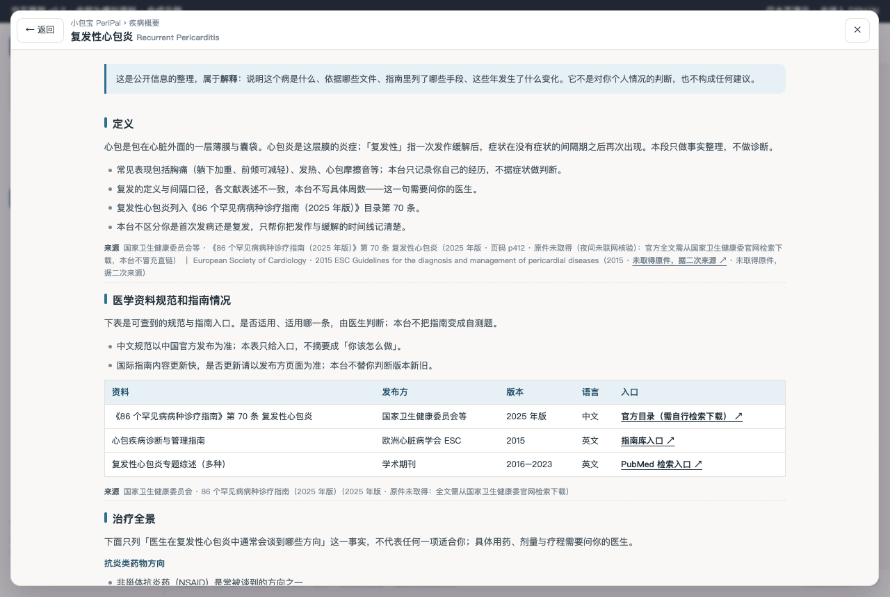
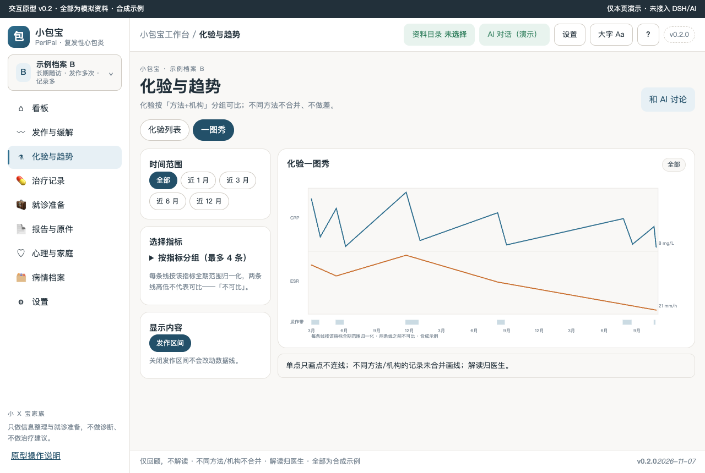
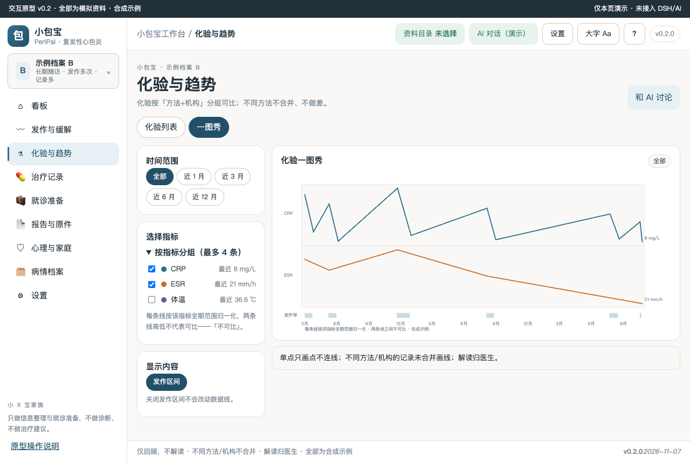
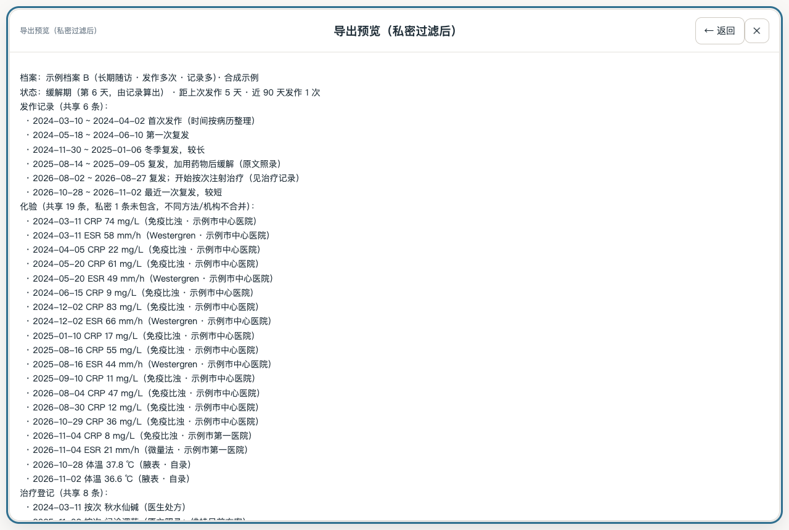
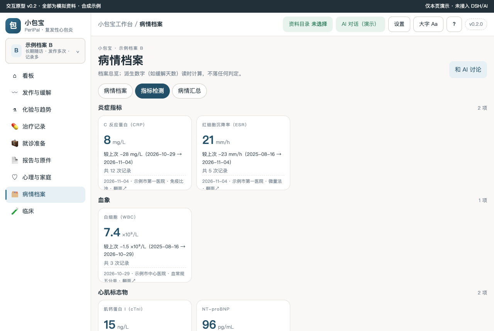
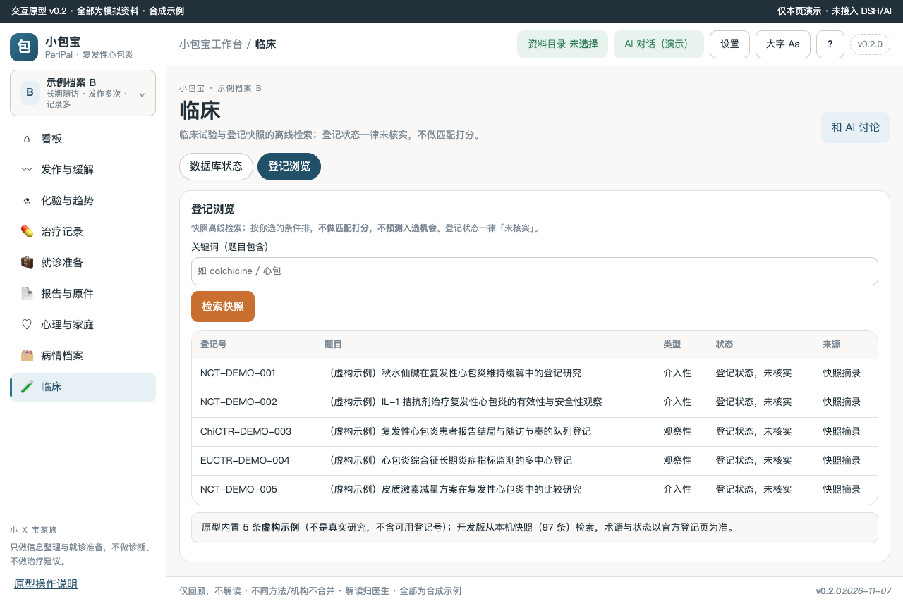

# 小包宝 PeriPal · 复发性心包炎工作台

本机优先的复发性心包炎发作—缓解记录、CRP/ESR 化验趋势、按次治疗登记、复诊准备工作台（合成演示）。DSH Desktop 开发版（M5）：界面由 `public/` 提供（与 `prototypes/v0.2` 定点移植同源），数据落 SQLite（`config.root = dshHomePath('pericarditis')`）。独立启动：`npm start -- --root <资料目录>`。认领依据：[Issue #62](https://github.com/xyb-openharness-dsh-plugins/.github/issues/62)（罕见病 #70 · R2 · T2）。

## 疾病概要

复发性心包炎指心包炎症状在无症状间隔后再次出现的慢性病程，属《86 个罕见病病种诊疗指南（2025 年版）》目录第 70 条。患者日常最关心的不是「分型分期」，而是**发作与缓解的规律、炎症化验的趋势、按次治疗的记录、复诊时能带着清单去**。本台按这个优先级组织，全部内容只做事实整理：仅回顾，不解读；不同方法/机构不合并；解读归医生。顶栏「?」可随时打开整页疾病概要（定义 → 医学资料规范和指南情况 → 治疗全景 → 发展趋势，每段带来源行）。

**如实声明：0 患者访谈、0 临床审核**（场景句为改写描述，标注待验证；阈值一律【待核】）。

### 定义

心包是包在心脏外面的一层薄膜与囊袋。心包炎是这层膜的炎症；「复发性」指一次发作缓解后，症状在没有症状的间隔期之后再次出现。本段只做事实整理，不做诊断。复发的定义与间隔口径各文献表述不一致，本台不写具体周数——这一句需要问你的医生。复发性心包炎列入《86 个罕见病病种诊疗指南（2025 年版）》目录第 70 条。

### 医学资料规范和指南情况

下表是可查到的规范与指南入口：中文规范以《86 个罕见病病种诊疗指南（2025 年版）》第 70 条（国家卫生健康委员会等，官方全文需自行检索下载）为准；国际以 ESC 2015 心包疾病指南为代表（escardio.org/Guidelines）；学术综述可在 PubMed 检索。是否适用、适用哪一条，由医生判断；本台不把指南变成自测题。

### 目前治疗全景概要

只列「医生在复发性心包炎中通常会谈到哪些方向」这一事实，不代表任何一项适合你：抗炎类药物方向（NSAID、秋水仙碱常作为减少复发的方向之一被谈到）、糖皮质激素的使用语境较复杂、生物制剂方向（IL-1 拮抗剂在部分国家获批；中国境内可及性与医保状态本台没有可靠信息）、随访与复查方向（CRP 复查、心脏超声观察积液，频率与项目以医生安排为准【待核】）。具体用药、剂量与疗程需要问你的医生。

### 发展趋势

只写已经发生的事实，不预测：2021 年 rilonacept（IL-1 通路拮抗剂）获美国 FDA 批准用于复发性心包炎（登记信息可在 FDA 官网查询）；国内已有多项管理与 IL-1 拮抗剂的学术讨论与研究登记（ClinicalTrials.gov 可检索登记条目）。本台不预测任何治疗何时可用；可及性变化以官方发布为准。

## 关键功能（截图墙）

### 1. 看板：状态卡 + 医生行动计划原话

首屏状态卡直接回答「现在缓解第几天、距上次发作多久、近 90 天发作几次」——数字由你记录的发作事件算出，不是医生判断。医生行动计划只照录原话。

### 2. 化验一图秀：按方法分组可比线

每条线按该指标全期范围归一化，两条线之间「不可比」；单点只画点不连线；不同方法/机构不合并画线；关闭发作带不改数据线。

### 3. 发作—缓解时间线区间带

色带=一次发作区间，圆点=缓解开始，菱形=治疗或复诊；非肿瘤语义，无 D+N 天数。

### 4. 指标卡 3D 翻转

正面：最近值/差值/次数/来源；背面：走势缩略图。定高 194px，翻转不改变栅格。

### 5. 疾病概要（整页，顶栏「?」或首页入口）

四段固定结构，每段带来源行（原件/官方入口/二次来源/未取得，分开标注），趋势段只写已发生的事实。

### 6. 折叠收/展态（一图秀指标选择）


原生 details 折叠；打印与键盘语义保留。

### 7. 整页视图（导出预览，私密过滤）

返回/关闭双入口、Esc 一层一退、history 为导航栈唯一真源；导出预览与看板摘要、AI 上下文共用同一私密过滤函数。

### 8. 设置弹层 / 临床页 / 指标分组（0.1.1 晨审修复）

设置=顶栏弹层三 tab（工作区/文档解析 MinerU/临床数据库），乳腺癌同款交互。

指标体系 8 项 5 组：炎症（CRP/ESR）、血象（WBC）、心肌标志物（cTnI/NT-proBNP）、用药安全监测（ALT/Cr）、体征（体温）。

「临床」一级菜单：数据库状态（通道终态如实，FAILED 不冒充零结果）+ 登记浏览（快照 97 条；无匹配打分，登记状态未核实）。

### 9. 其余实渲截图
- [AI 演示面板](docs/screenshots/v0.2-02-agent-pane.png)（右侧 35% 可拖 25–45%，未接通明说）
- [设置 · 文档解析 MinerU](docs/screenshots/v0.2-10-settings-mineru.png)（未勾选不上传；本仓未接入如实标注）
- [窄宽 390](docs/screenshots/v0.2-11-narrow-390.png)（无横向溢出）

## 怎么用

1. 浏览器直接打开 `prototypes/v0.2/index.html`（file:// 可用，全部为合成示例）。
2. 侧栏「示例档案 A/B」切换两套演示档案：A 刚确诊记录少、B 多年随访发作多次；切换后整页联动，会话与草稿按档案隔离。
3. 顶栏：资料目录 → AI 对话（演示） → 设置 → 大字 → **?** → 版本。
4. 「和 AI 讨论」只把草稿填入输入框，不自动发送；发送键在演示态禁用。

## 数据与口径

- 演示数据唯一源：`prototypes/v0.2/demo-data.js`（两套合成档案；页面不写死业务数字）。
- 口径：仅回顾，不解读；不同方法/机构不合并；解读归医生。私密记录不进看板摘要、导出与 AI 上下文。
- 阈值、疗程、可及性一律【待核】；本台无试验线前端（裁剪理由见 docs/DEV-PLAN.md §四），临床快照状态在设置页如实显示。

## 开发

```bash
npm run check   # 静态检查链（含探针覆盖断言）
npm test        # 单测
npm run audit   # 家族一致性检查
node scripts/probe-pericarditis-m2.mjs        # M2 真实浏览器探针（IP/C/MT/Q/A 组）
node scripts/probe-disease-primer.mjs --url http://127.0.0.1:8127/prototypes/v0.2/index.html
node scripts/probe-page-view.mjs --url http://127.0.0.1:8127/prototypes/v0.2/index.html
```
版本 0.1.1（包）/ 原型 v0.2；文档九件见 docs/；各闸口签认见 docs/signoffs/。
